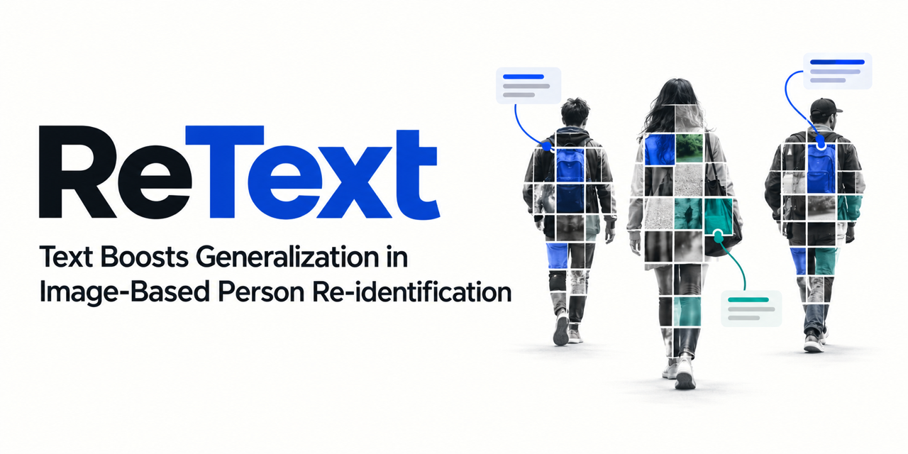
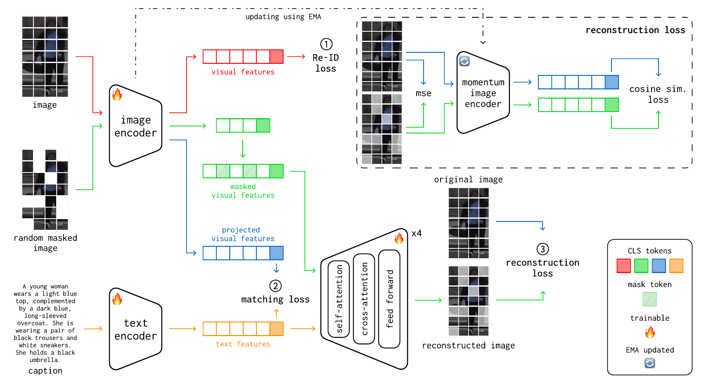

<p align="center">
  
</p>

<div align="center">

# ReText: Text Boosts Generalization in Image-Based Person Re-identification

**Timur Mamedov<sup>1,2,&#42;</sup> · Karina Kvanchiani<sup>1,&#42;</sup> · Anton Konushin<sup>2</sup> · Vadim Konushin<sup>1</sup>**

<sup>1</sup> Tevian, Moscow, Russia &nbsp; <sup>2</sup> Lomonosov Moscow State University  
<sup>&#42;</sup> Equal contribution

**Accepted by WACV 2027** · [Paper (arXiv)](https://arxiv.org/abs/2602.05785)

[Overview](#overview) · [Method](#method) · [Results](#results) · [Release Status](#release-status) · [Citation](#citation)

</div>

> [!IMPORTANT]
> **Generated textual annotations and fine-tuned VLM weights are available below.**
> See [textual annotations](#textual-annotations) and [VLM weights and captioning instructions](llava_weights/README.md).

## Overview

ReText learns person representations that generalize to unseen camera domains without retraining. It uses descriptive natural language during training to enrich visual features with semantic cues, helping the model focus on appearance attributes such as clothing and accessories.

The method combines multi-camera person Re-ID data with stylistically diverse single-camera data and jointly learns identity discrimination, image-text alignment, and text-guided image reconstruction. **At inference, only the momentum image encoder is used; no captions, text encoder, or reconstruction decoder are required.**

- **Semantic supervision:** descriptive captions provide appearance cues that are more stable across domains.
- **Complementary data:** multi-camera images supply cross-view variation; single-camera images and captions add visual diversity and language supervision.
- **Identity-aware alignment:** the proposed matching and structure-preserving losses account for multiple samples of the same person.

## Method

<p align="center">
  
</p>
<p align="center"><em>Figure 2 from the manuscript. ReText jointly optimizes three complementary training tasks.</em></p>

| Task | Objective | Role |
| :--- | :--- | :--- |
| **1. Person re-identification** | Instance, augmentation, centroid, and camera-centroid losses | Learn identity-discriminative features across camera views. |
| **2. Image-text matching (ITM)** | Identity-aware Matching Loss + Structure-preserving Loss | Align images with descriptive captions while preserving intra-identity structure in the shared embedding space. |
| **3. Text-guided image reconstruction (IR)** | Masked-patch mean squared error + semantic cosine similarity loss | Reconstruct masked images using text and encourage robustness to missing or occluded visual information. |

The architecture comprises a ViT-Base image encoder, an exponential-moving-average (EMA) momentum image encoder, a BERT-Base text encoder, and an image decoder. In the mixed-data configuration, the Re-ID objective is applied only to multi-camera data.

### Training configurations

The manuscript reports two configurations; they use different sources of textual supervision:

| Configuration | Multi-camera data | Single-camera data |
| :--- | :--- | :--- |
| **ReText (Mt)** | Images with generated captions | Not used |
| **ReText (MSt)** | Images without captions | SYNTH-PEDES images with captions |

For multi-camera annotation, LLaVA-1.6-7B is fine-tuned on UFine3C to generate descriptions at different granularities. The expanded datasets are **CUHK03-NP, Market-1501, MSMT17, CUHK-SYSU, and RandPerson**. Caption filtering removes repeated phrases and discards descriptions exceeding 150 words.

## Results

### Cross-domain person re-identification

We compare ReText with [DynaMix](https://www.sciencedirect.com/science/article/pii/S0925231225031182), our previous state-of-the-art method for generalizable person re-identification.

Results below are transcribed from **Table 3 of the manuscript**. Each cell reports **Rank-1 / mAP (%)**. Models are evaluated on unseen target datasets without target-domain retraining. The training source column specifies the multi-camera dataset; ReText (MSt) additionally uses SYNTH-PEDES with captions.

| Multi-camera training source | Method       |   → CUHK03-NP   |  → Market-1501  |    → MSMT17     |
| :--------------------------- | :----------- | :-------------: | :-------------: | :-------------: |
| Market-1501                  | DynaMix      |   51.0 / 52.2   |        —        |   65.5 / 36.7   |
| Market-1501                  | ReText (Mt)  | **57.6 / 58.2** |        —        |   66.2 / 39.4   |
| Market-1501                  | ReText (MSt) | **57.6** / 57.5 |        —        | **70.1 / 43.1** |
| MSMT17                       | DynaMix      |   48.9 / 49.6   |   91.1 / 77.7   |        —        |
| MSMT17                       | ReText (Mt)  |   61.9 / 61.8   |   93.3 / 81.4   |        —        |
| MSMT17                       | ReText (MSt) | **63.4 / 63.1** | **93.6 / 83.6** |        —        |
| RandPerson                   | DynaMix      |   36.9 / 39.3   |   89.3 / 72.4   |   67.1 / 36.5   |
| RandPerson                   | ReText (Mt)  |   44.2 / 44.1   |   90.7 / 76.4   |   67.9 / 39.7   |
| RandPerson                   | ReText (MSt) | **46.9 / 47.7** | **91.7 / 79.7** | **70.8 / 42.3** |

**Highlights:** with MSMT17 as the multi-camera training source, ReText (MSt) improves mAP over DynaMix by **13.5 percentage points on CUHK03-NP** and **5.9 percentage points on Market-1501**.

Bold marks the best score among the displayed methods for each training source and target. “—” omits same-domain results to keep this table focused on generalization. DynaMix is a selected comparison from the manuscript; see Table 3 for the complete benchmark comparison.

### Effect of textual supervision

**Table 2** isolates the effect of adding captions to multi-camera training data, without additional single-camera images. The training source is MSMT17; scores are **Rank-1 / mAP (%)**.

| Training data | CUHK03-NP | Market-1501 | Average |
| :--- | :---: | :---: | :---: |
| Multi-camera images without text | 42.8 / 43.3 | 89.1 / 71.7 | 66.0 / 57.5 |
| Multi-camera images with text — ReText (Mt) | **61.9 / 61.8** | **93.3 / 81.4** | **77.6 / 71.6** |

Adding descriptive captions increases the reported average mAP by **14.1 percentage points**.

## Release Status

| Resource | Location |
| :--- | :--- |
| Generated textual annotations | [texts_for_multi_camera](texts_for_multi_camera) |
| Fine-tuned VLM weights and captioning instructions | [llava_weights](llava_weights/README.md) |

### Textual annotations

Each JSON file maps an image path to its generated caption. The counts below describe the released files. Original dataset images are not included.

| Dataset | Annotations | Entries |
| :--- | :--- | ---: |
| CUHK-SYSU | [cuhk-sysu.json](texts_for_multi_camera/cuhk-sysu.json) | 23,435 |
| CUHK03 | [cuhk03.json](texts_for_multi_camera/cuhk03.json) | 28,193 |
| Market-1501 | [market-1501.json](texts_for_multi_camera/market-1501.json) | 36,036 |
| MSMT17 | [msmt17.json](texts_for_multi_camera/msmt17.json) | 126,441 |
| RandPerson | [randperson.json](texts_for_multi_camera/randperson.json) | 132,145 |

### VLM weights

The [VLM release](llava_weights/README.md) contains the fine-tuned weights, model configuration, and a script for captioning your own images. The weights are stored with Git LFS; the base LLaVA and CLIP models are loaded separately by the script.

## Citation

```bibtex
@article{mamedov2026retext,
  title={ReText: Text boosts generalization in image-based person re-identification},
  author={Mamedov, Timur and Kvanchiani, Karina and Konushin, Anton and Konushin, Vadim},
  journal={arXiv preprint arXiv:2602.05785},
  year={2026}
}
```

[Download BibTeX](CITATION.bib)
